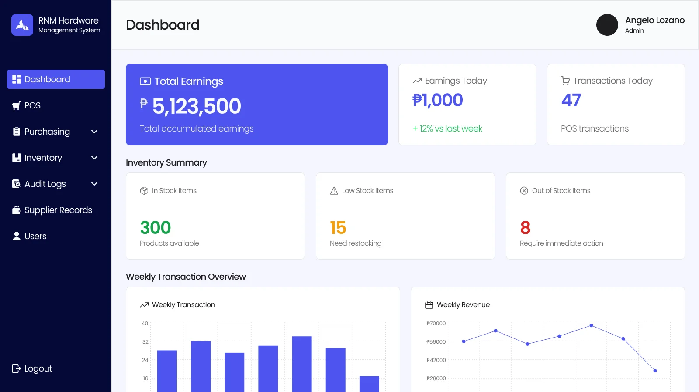
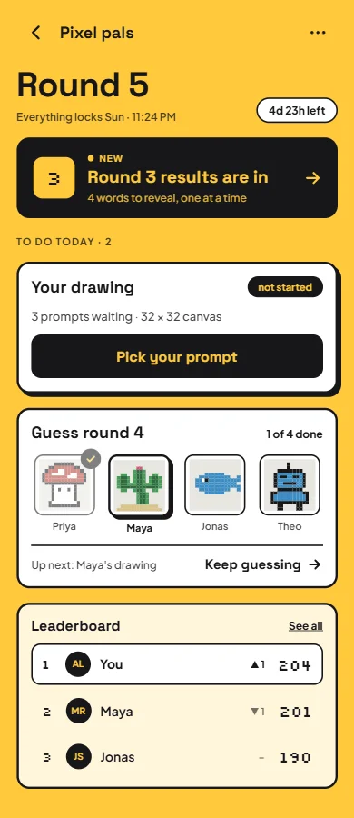
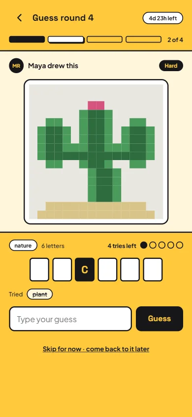
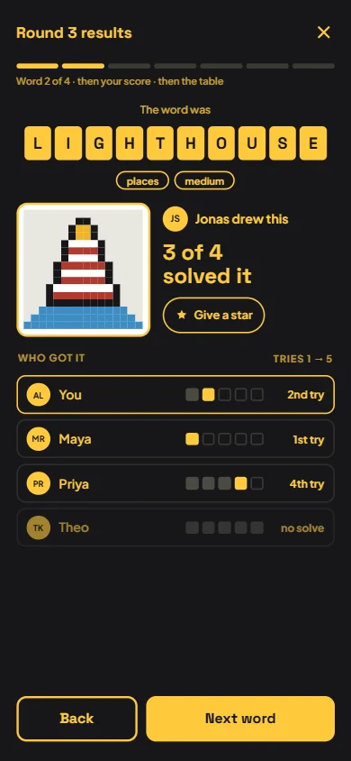

# Robroi Neo Dingal

**Software Engineer · open to remote roles** · Davao, Philippines

Hey, I'm Rob, a computer science graduate and engineer based in Davao, Philippines. I build web apps,
care about interfaces that feel clear and fast, and make small games when the itch hits.

This repository is the source of my personal portfolio site.

<p>
  <a href="mailto:robroineo2@gmail.com">Email</a> ·
  <a href="https://github.com/robroi-neo">GitHub</a> ·
  <a href="https://x.com/robneodev">X</a> ·
  <a href="public/resume/Resume.pdf">Résumé (PDF)</a>
</p>

---

## Projects

### Hardware Management System

A hardware management system for an SME, with a functional POS, invoicing, inventory, permissions and
auth, and a dashboard.

**Laravel** · [Source code](https://github.com/robroi-neo/Hardware-Management-System)



### Pixel Pal

A multiplayer guessing game built around pixel art, for up to 8 players.

**Flutter · Firebase** · [Source code](https://github.com/robroi-neo/pixel-pal)

<p>
  
  
  
</p>

### Terraria Wiki Bot

A Terraria wiki chatbot using LLMs with retrieval-augmented generation (RAG), deployed on Streamlit.

**Ollama · Python · Streamlit** · [Source code](https://github.com/robroi-neo/terraria-wiki-chatbot)

### Reinforcement Learning with Snake (DQN & Dual DQN)

A Snake game that learns to play itself with deep Q-learning.

**Python · Reinforcement Learning** · [Source code](https://github.com/robroi-neo/snake-deep-q-network)

---

## Experience

**Software Engineer Intern — [Kumosoft LLC](https://www.kumo-soft.com/)** · 2026 – present

Laravel + JavaScript development. Built the dental odontogram (interactive tooth chart) module.

- Designed the database schema for the dental module and integrated it into the existing database.
- Designed the mobile-first layout for the odontogram.
- Researched and documented the domain and business logic, like tooth anatomy and surfaces, caries,
  and other conditions, to define the module's features.

**Computer Science Student — [University of Mindanao](https://umindanao.edu.ph/)** · 2023 – 2026

Specialized in machine learning and AI. Built everything from business systems like POS and inventory
to AI-driven projects.

- Marketing Head of UM Enigma, a university tech org, leading the creatives and marketing department.
- Modified a Random Forest model for my thesis, and applied CNN, NLP, and classical ML models across
  projects.
- Built a POS, inventory, and transactions system demo for a local hardware store.

---

## Stack

| | |
| --- | --- |
| **Frontend** | React, JavaScript, HTML, CSS |
| **Backend** | Laravel (PHP), Node.js |
| **Data** | SQL, MariaDB, SQLite |
| **ML / AI** | Python, TensorFlow |
| **Tools** | Git, GitHub, VS Code |

---

## About this site

A one-page portfolio built with **React 19** and **Vite**. It has no UI or animation libraries: the
layout, motion and components are plain CSS and React.

- **Dock navigation.** A floating dock that highlights the section in view.
- **Light and dark mode.** The new theme spreads out in a circle from the toggle button.
- **Project fan.** Cards spread apart on hover and open a popup with a swipeable screenshot gallery.
- **Mixtape music card.** A cassette that plays my most-replayed song through Spotify's embedded
  player. Its reels spin, and the tape winds from one side to the other as the song plays.
- **Stack dock.** Icons magnify macOS-style under the pointer, with category filters.
- **Contact form.** Opens the visitor's email app with the message filled in, or can post to a form
  backend.
- **Handwritten sign-off.** The footer signature writes itself out stroke by stroke.
- **Accessibility.** Real buttons and links, keyboard support, visible focus, and screen-reader
  labels.

### Run it locally

```bash
npm install
npm run dev       # start the dev server
npm run build     # production build in dist/
npm run preview   # serve the production build
npm run lint      # ESLint
```

### Edit the content

Content lives in data files, so updating the site rarely means touching components:

| What | File |
| --- | --- |
| Name, role, email, photo | `src/data/profile.js` |
| Projects (screenshots in `public/projects/`) | `src/data/projects.js` |
| Experience | `src/data/experience.js` |
| Résumé link (PDF in `public/resume/`) | `src/data/resume.js` |
| Stack | `src/data/stack.js` |
| Contact links and form endpoint | `src/data/contact.js` |
| Song on the music card | `src/data/now-playing.json` |
| Dock sections | `src/data/sections.js` |
| Colors, fonts, spacing (light and dark) | `src/styles/tokens.css` |

### Project structure

```text
public/            static files: favicon, photo, project screenshots, résumé, stack icons
src/
  components/      page sections and UI (Hero, ProjectFan, Experience, Stack, Contact, …)
    MixtapeCard/   the cassette music player
  data/            all site content (see above)
  hooks/           small reusable behaviours (theme, clock, in-view, active section, …)
  lib/             helpers (View Transitions)
  styles/          design tokens, base styles, layout
```

### Credits

- Icons from [Lucide](https://lucide.dev) (ISC).
- Tech logos from [Simple Icons](https://simpleicons.org) (CC0) and [Devicon](https://devicon.dev) (MIT).
- Signature lettering generated from the Hershey Script single-stroke font, via
  [hersheytext](https://github.com/techninja/hersheytext) (MIT).
- Fonts: [Geist and Geist Mono](https://vercel.com/font) and [Caveat](https://fonts.google.com/specimen/Caveat),
  from Google Fonts.
